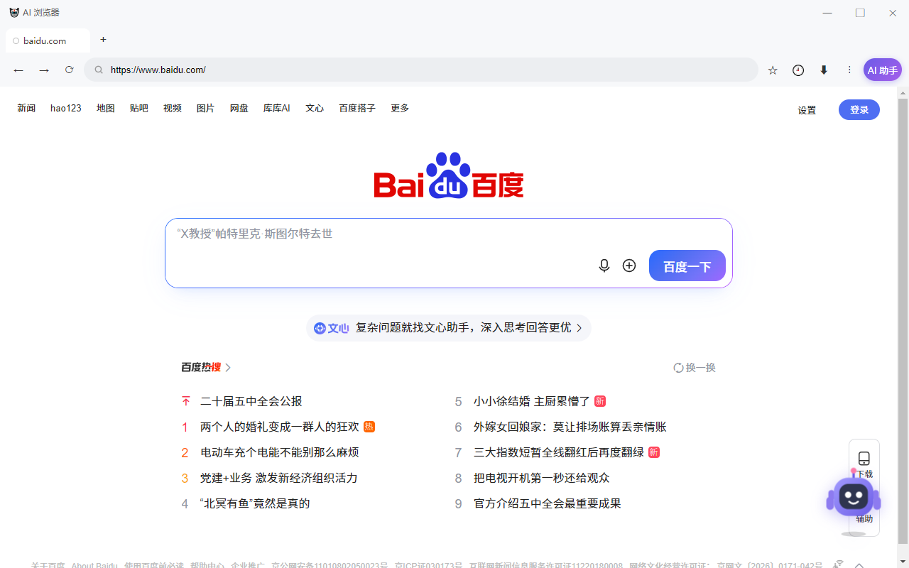

# AI 浏览器（liulanqi）

> 一个带 AI 助手的 Windows 浏览器：说一句话，让它替你搜、替你点、替你总结。

基于 Chromium 内核 + Electron 外壳，界面和操作习惯与 Chrome 一致，额外内置了 AI 能力和小人物助手。

## 它和普通浏览器有什么不同

### 🤖 说到就能做到
在对话框里输入 **"打开百度"**、**"在淘宝搜一下蓝牙耳机"**、**"登录这个网站"**，
AI 会自己打开网页、点击链接、填写搜索框，你只需要看结果。

> 不需要记命令，也不用手动一步步操作。

### 💬 让 AI 读懂你正在看的页面
- **📄 总结此页**：一键把当前网页提炼成要点
- **✂️ 划词问 AI**：选中任何文字，浮出"问 AI"气泡，翻译/解释/总结
- **📷 截图问 AI**：截取当前页面，让 AI 解读图片内容
- **🐛 帮看报错**：网页报错时自动捕获，用人话解释原因并给出解决办法（别家浏览器没有）

### 🧑‍💼 小人物助手
右下角有个会动的小家伙：
- 点它就打开聊天框，直接打字使唤
- 有表情和动作：思考时天线闪、你说话时它听、任务完成会开心蹦
- 没事会提醒你"上次看的那个要不要接着看"

### 🎙️ 语音对话
- 🎤 点一下开始说话，识别后自动发送
- 🔊 AI 回复自动朗读（Windows 本地语音合成，不联网）

## 新标签页可以自己定制

默认那排常用网站（百度、哔哩哔哩、知乎…）都能改：

- **删除**：鼠标移到图标上，点右上角的 **×**
- **添加**：点末尾的 **＋**，填名称和网址；也可以点"从书签里选一个"直接从你的收藏里挑
- **恢复默认**：页面底部"恢复默认网站"

设置自动保存在本机，下次打开还在。

## 支持 Chrome 扩展

设置 → 扩展 → **添加扩展**，选一个解包好的 Chrome 扩展目录（含 manifest.json）即可。
Manifest V2 和 V3 都支持。

> 说明：Electron 未实现部分 Chrome 专有接口，少数依赖这些接口的扩展可能功能受限
> （如依赖 chrome.identity 登录、部分企业策略接口）。内容脚本类扩展（去广告、改页面样式、
> 翻译划词等）通常可正常工作。

## 数据同步（不需要自己搭服务器）

### 方式一：网盘同步文件夹（最省事，推荐）

百度网盘、阿里云盘、OneDrive、坚果云这些网盘在电脑上都有个**同步文件夹**，放进去的文件会自动传到云端。

设置 → 数据同步 → **同步文件夹**：软件会自动检测你电脑上已有的网盘文件夹，点一下就能选用；也可以点「选择」手动指定。

再设一个**同步口令**（至少 4 位，每台设备要一样），打开**自动同步**即可：

- 改了书签、密码，几秒后自动写入并上传
- 换电脑/重装：选同一个文件夹 + 同一个口令 → 点「从文件夹恢复」
- 别的设备更新了，右下角小人物会提醒你恢复

> 浏览器只往这个文件夹里写一个 liulanqi-sync.lqs 文件，其余文件不碰。

**各网盘的真实情况（先看再选）：**

| 网盘 | 支持情况 |
|---|---|
| OneDrive | ✅ Windows 自带，双向同步，最推荐 |
| 坚果云 | ✅ 免费版就有同步文件夹「我的坚果云」 |
| 百度网盘 | ⚠️ 「同步空间」功能需要网盘会员，免费用户没有 |
| 阿里云盘 | ⚠️ 客户端是单向备份（改动自动上传）；换电脑时需先在网盘里手动把文件下载下来，再导入 |

> 不想折腾网盘？用「导出到文件」生成加密文件，微信/U 盘拷到新电脑「从文件导入」，效果一样。

### 方式二：WebDAV（坚果云、Nextcloud、群晖原生支持）

设置 → 数据同步，三件事：

- **导出成文件**：生成一个加密文件，自己拷到别的电脑导入
- **导入文件**：恢复书签、密码、设置、AI 记忆
- **WebDAV 云同步**：填自己的 WebDAV 地址即可（坚果云、Nextcloud、群晖等都有免费额度），
  一键上传/恢复

🔒 **端到端加密**：所有数据用你自己设的口令做 AES-256-GCM 加密，
云端或文件里只有密文，服务商看不到你的书签和密码。口令丢了数据就解不开，请记牢。

## 浏览器基本功也都有

标签页多开 · 书签栏 · 历史记录 · 下载管理（多线程 + 断点续传）· 无痕模式 ·
密码保存与自动填充（本机加密）· 强密码生成 · 广告拦截 · 视频小窗 ·
开发者工具（F12）· 右键菜单 · 查看源代码 · 打印 · 全屏 ·
标签页休眠省内存 · 3 套皮肤主题 · 标签分组 · PDF 查看 ·
鼠标手势 · 快捷键自定义 · 代理设置 · 中英文界面

## 下载安装

在右侧 **Releases** 里下载最新的安装包，双击安装即可（约 77MB）。

**安装时如果提示"未知发布者"**：这是因为暂时没有购买代码签名证书，不是病毒。
点 **"更多信息" → "仍要运行"** 即可正常安装。

要求：Windows 10 / 11 64 位。

## 第一次使用：配置 AI

AI 功能需要一个大模型的 API Key（自己申请，通常有免费额度）：

1. 打开浏览器 → 点右上角 **⋮** → **设置** → 找到 **AI 助手** 区块
2. **服务商**选一个（推荐 **智谱清言 GLM**，有免费模型；或 DeepSeek，便宜好用）
3. 把申请到的 **API Key** 填进去
4. 点 **"测试连接"** 确认通，再点 **"保存 AI 设置"**

配好后所有 AI 功能立刻可用。

## 自动更新

浏览器启动时会自动检查新版本，发现更新会在设置页提示，点一下就能升级。
也可以在 设置 → 软件更新 里手动检查。

## 常见问题

**Q：提示"未知发布者"不敢装？**
A：正常的，因为没买数字签名证书（一年几百到几千元）。点"更多信息 → 仍要运行"即可。

**Q：AI 说"没配 API key"？**
A：去设置页按上面步骤填一个。留空时 AI 功能是占位回复。

**Q：让它打开网页没反应？**
A：先确认设置页 AI 状态是"已配置"，并且 key 有余额/没被限流。部分免费 key 有调用频率限制。

**Q：同步的加密口令忘了怎么办？**
A：无法找回，加密数据解不开。建议用自己记得住的，或记在密码管理器里。

**Q：会收集我的数据吗？**
A：浏览记录、书签、密码都只存在你自己的电脑上（密码用系统加密）。只有你主动使用 AI 时，
对话内容才会发给你配置的那家 AI 服务商。同步功能也只上传你自己加密后的密文。

## 更新记录

### v0.1.4（2026-10-30）
- 同步文件夹自动检测（OneDrive/坚果云/百度网盘），一键选用
- 设置页写明各网盘真实支持情况（百度需会员、阿里云盘为单向备份）
- 修复 WebDAV 配置无法记住的问题

### v0.1.3（2026-10-30）
- 📁 网盘文件夹同步（百度网盘/阿里云盘/OneDrive/坚果云通用）+ 自动同步与远端变更提醒

### v0.1.2（2026-10-30）
- 🧩 支持 Chrome 扩展（MV2/MV3）
- ☁️ 数据同步：书签/密码/设置/AI 记忆的加密导出导入 + WebDAV 云同步（端到端加密）

### v0.1.1（2026-10-30）
- 新标签页的常用网站可自己管理：悬停点 × 删除、点 ＋ 添加（支持从书签挑选）、一键恢复默认

### v0.1.0（2026-10-30）
- 首个版本：AI 对话找东西、Agent 自动操作网页、AI 读页面、帮看报错、划词问答、截图读图
- 小人物 2D 形象（8 种表情动作）+ 主动提醒
- 语音输入 + 语音朗读
- 浏览器基本功全套 + 鼠标手势 + 快捷键自定义 + 代理 + 中英文界面
- 自动更新

---

*本仓库仅用于发布安装包，不含源代码。*
