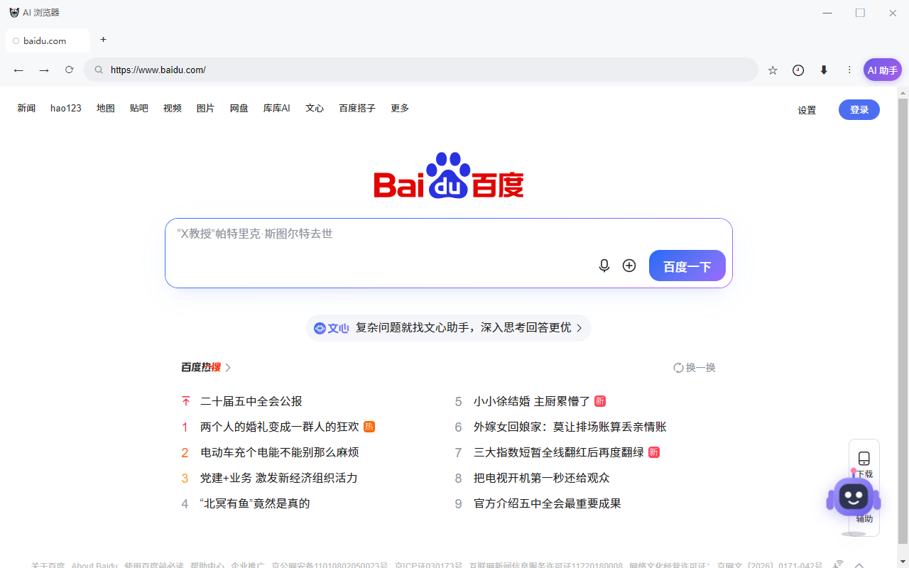

# AI 浏览器（liulanqi）

> 一个带 AI 助手的 Windows 浏览器：说一句话，让它替你搜、替你点、替你总结。

基于 Chromium 内核 + Electron 外壳，界面和操作习惯与 Chrome 一致，额外内置了 AI 能力和小人物助手。

## 它和普通浏览器有什么不同

### 🤖 说到就能做到
在对话框里输入 **"打开百度"**、**"在淘宝搜一下蓝牙耳机"**、**"登录这个网站"**，
AI 会自己打开网页、点击链接、填写搜索框，你只需要看结果。

> 不需要记命令，也不用手动一步步操作。

### 💬 让 AI 读懂你正在看的页面
- **📄 总结此页**：一键把当前网页提炼成要点
- **✂️ 划词问 AI**：选中任何文字，浮出"问 AI"气泡，翻译/解释/总结
- **📷 截图问 AI**：截取当前页面，让 AI 解读图片内容
- **🐛 帮看报错**：网页报错时自动捕获，用人话解释原因并给出解决办法（别家浏览器没有）
- **🌐 整页翻译**：不配 Key 也能用（免费翻译接口自动降级），配了 Key 质量更高
- **🪄 AI 全能表单**：资料卡填一次，任何网页点「🪄」自动填姓名/手机/邮箱——你检查后自己点提交

### 🧑‍💼 小人物助手
右下角有个会动的小家伙：
- 点它就打开聊天框，直接打字使唤
- 有表情和动作：思考时天线闪、你说话时它听、任务完成会开心蹦
- 没事会提醒你"上次看的那个要不要接着看"

### 🎙️ 语音对话
- 🎤 点一下开始说话，识别后自动发送
- 🔊 AI 回复自动朗读（Windows 本地语音合成，不联网）

## 数据放哪、换电脑怎么办（重装不丢）

### 数据存哪

**跟着安装盘走，不占 C 盘**：装在 `E:\ailiulanqi`，数据就在 `E:\ailiulanqi\data`（书签、密码、设置、AI 记忆）+ `E:\ailiulanqi\user`（网站登录状态）。设置 → 数据同步 → 「本机数据位置」可以直接看到。

密码用 Windows 系统级加密（DPAPI）存储；旧版本存在 C 盘 AppData 的数据，升级后第一次启动会**自动搬到安装盘**。

### 换电脑三条路（都不需要给应用任何网盘授权）

| 方式 | 怎么用 | 适合 |
|---|---|---|
| **网盘同步文件夹**（推荐） | 设置 → 数据同步 → 选网盘客户端的同步文件夹（自动检测 OneDrive/坚果云/百度网盘），设一个同步口令 | 日常自动备份 |
| **WebDAV** | 填坚果云/Nextcloud/群晖的 WebDAV 地址 | 有 NAS 或坚果云的重度用户 |
| **导出/导入文件** | 「导出到文件」生成加密文件，微信/U 盘拷走，「从文件导入」 | 不想装网盘客户端 |

| 网盘 | 上传（备份） | 恢复到新电脑 |
|---|---|---|
| OneDrive | ✅ 全自动 | ✅ 全自动 |
| 坚果云 | ✅ 全自动 | ✅ 全自动 |
| 百度网盘 | ✅ 自动（客户端「备份 → 文件夹备份」选本文件夹，免费） | 🖱 手动一步：把 liulanqi-sync.lqs 下载下来 → 「从文件导入」 |
| 阿里云盘 | ✅ 自动 | 🖱 手动一步：同上 |

### 重装系统 / 卸载重装，数据会丢吗？

**不会。** 两道保险：

1. **卸载时**：安装脚本自动把数据搬到安装盘根目录的 `AI浏览器-数据备份` 文件夹（卸载器删不到）
2. **重装后第一次启动**：浏览器自动扫描所有磁盘的常见位置，找到旧数据就**自动恢复**——启动后小人物会告诉你找回多少书签和密码

> 🔒 所有同步内容用你自己的口令做 **AES-256-GCM 端到端加密**：口令只在本机、从不上传，网盘上只有密文。口令丢了数据就解不开，请记牢。
>
> 📖 逐步教程：[数据同步使用教程](https://ai.useaiwriter.com/sync-guide.md)

## 新标签页可以自己定制

默认那排常用网站（百度、哔哩哔哩、知乎…）都能改：

- **删除**：鼠标移到图标上，点右上角的 **×**
- **添加**：点末尾的 **＋**，填名称和网址；也可以点"从书签里选一个"直接从你的收藏里挑
- **恢复默认**：页面底部"恢复默认网站"

设置自动保存在本机，下次打开还在。

## 支持 Chrome 扩展

设置 → 扩展 → **添加扩展**，选一个解包好的 Chrome 扩展目录（含 manifest.json）即可。
Manifest V2 和 V3 都支持。

> 说明：Electron 未实现部分 Chrome 专有接口，少数依赖这些接口的扩展可能功能受限
> （如依赖 chrome.identity 登录、部分企业策略接口）。内容脚本类扩展（去广告、改页面样式、
> 翻译划词等）通常可正常工作。

## 浏览器基本功也都有

标签页多开 · 书签栏 · 历史记录 · 下载管理（多线程 + 断点续传）· 无痕模式 ·
密码保存与自动填充（本机加密）· 强密码生成 · 广告拦截 · 视频小窗 ·
开发者工具（F12）· 右键菜单（复制粘贴全选/翻译/问AI/打印）· 查看源代码 · 全屏 ·
标签页休眠省内存 · 3 套皮肤主题 · 标签分组 · PDF 查看 ·
鼠标手势 · 快捷键自定义 · 代理设置 · 中英文界面

## 下载安装

在右侧 **Releases** 里下载最新的安装包，双击安装即可（约 77MB）。

> 安装向导里可以**自己选择安装到哪个盘**（默认 C 盘，可以改成 D/E 盘）——建议装到非 C 盘，数据会跟着走。

**安装时如果提示"未知发布者"**：这是因为暂时没有购买代码签名证书，不是病毒。
点 **"更多信息" → "仍要运行"** 即可正常安装。

要求：Windows 10 / 11 64 位。

## 第一次使用：配置 AI

AI 功能需要一个大模型的 API Key（自己申请，通常有免费额度）。全部 OpenAI 兼容，设置页「自定义」直填。

**🆓 完全免费长期可用（推荐先试，一分钱不花）**

| 服务商 | 接口地址 | 模型名 | 说明 |
|---|---|---|---|
| **美团 LongCat** | `https://longcat.chat` 平台申请 | `LongCat-Flash`、`LongCat-Flash-Thinking` | **免费额度最大**（每日可领 token），工具调用能力评测登顶，**AI 自动操作首选免费档** |
| 智谱 | `https://open.bigmodel.cn/api/paas/v4` | `glm-4-flash` | 免费 128K 上下文，速度快，日常对话够用 |
| 百度千帆 | `https://qianfan.baidubce.com/v2` | `ernie-speed`、`ernie-lite` | 长期免费（限速），新用户每模型送 100 万 token |
| 腾讯混元 | `https://api.hunyuan.cloud.tencent.com/v1` | `hunyuan-lite` | 免费，256K 上下文（限 5 并发） |
| 硅基流动（聚合） | `https://api.siliconflow.cn/v1` | 一个 Key 十几个免费模型 | 想同时用 Qwen/GLM/MiniMax 多家模型的偷懒选择 |

**💰 低价高性价比（AI 自动操作流畅体验的最低消费，每月几块钱）**

| 服务商 | 接口地址 | 模型名 | 说明 |
|---|---|---|---|
| DeepSeek | `https://api.deepseek.com/v1` | `deepseek-chat` | JSON 稳、速度快（每步几秒），输入约 $0.14/百万 token |
| **智谱 GLM-5.3-Flash** | 同智谱地址 | `glm-5.3-flash` | **原生多模态：对话+视觉一个模型全搞定**（视觉模型栏可留空），价格约旗舰 1/20 |
| 字节豆包（火山方舟） | `https://ark.cn-beijing.volces.com/api/v3` | `doubao-seed-*` 系列 | 低价主力，新用户有免费 token |
| 阿里千问（百炼） | `https://dashscope.aliyuncs.com/compatible-mode/v1` | `qwen-plus` | 输入最低约 ¥0.125/百万 token |

**🏆 效果顶配（复杂跨站比价、长文档阅读最强）**

- 智谱 `glm-5.3`（旗舰）｜ Kimi `K2.5`（**超长上下文**）｜ Qwen `qwen-max` ｜ LongCat-Flash-Omni（全模态）｜ GPT 系（需中转）

**👁 视觉模型怎么填**（设置页「视觉模型」一栏，用于截图识别）：
- 免费方案：智谱 `glm-4v-flash`（完全免费）
- 一劳永逸方案：用 `glm-5.3-flash` 当对话模型——它自带视觉，视觉栏留空即可

> 💡 **选型口诀：先试美团 LongCat（免费额度最大）→ 想流畅上 deepseek-chat（每月几块钱）→ 要最强上旗舰档。** 免费政策随时可能调整，以各家官方页为准。

配置步骤：

1. 打开浏览器 → 点右上角 **⋮** → **设置** → 找到 **AI 助手** 区块
2. **服务商**选一个（或选「自定义」直接贴接口地址 + 模型名）
3. 把申请到的 **API Key** 填进去
4. 点 **"测试连接"** 确认通，再点 **"保存 AI 设置"**

> 💡 不配 Key 也有用：整页翻译走免费翻译接口、AI 填表走本地关键词匹配，零成本零配置。

## 自动更新

浏览器启动时会自动检查新版本，发现更新会在设置页提示，点一下就能升级。
也可以在 设置 → 软件更新 里手动检查。

## 常见问题

**Q：提示"未知发布者"不敢装？**
A：正常的，因为没买数字签名证书（一年几百到几千元）。点"更多信息 → 仍要运行"即可。

**Q：AI 说"没配 API key"？**
A：去设置页按上面步骤填一个。留空时 AI 对话是占位回复，但翻译和填表仍然可用。

**Q：让它打开网页没反应？**
A：先确认设置页 AI 状态是"已配置"，并且 key 有余额/没被限流。部分免费 key 有调用频率限制。

**Q：重装系统数据会丢吗？**
A：不会。卸载时数据被自动保送到安装盘根目录，重装后第一次启动自动扫描找回（书签、密码、AI 记忆都在）。

**Q：同步的加密口令忘了怎么办？**
A：无法找回，加密数据解不开。建议用自己记得住的，或记在密码管理器里。

**Q：会收集我的数据吗？**
A：浏览记录、书签、密码都只存在你自己的电脑上（密码用系统加密），数据文件就在安装目录里。只有你主动使用 AI 时，对话内容才会发给你配置的那家 AI 服务商。同步功能只上传你自己加密后的密文。详见[隐私政策](https://ai.useaiwriter.com/privacy.html)。

## 更新记录

### v0.3.8（2026-11-15）—— 重装不丢数据
- 🔎 重装后第一次启动自动扫描所有磁盘找回旧数据（书签/密码/AI 记忆）
- 📦 卸载时数据自动保送到安装盘根目录 `AI浏览器-数据备份`（卸载器删不到）

### v0.3.7（2026-11-15）—— 数据不占 C 盘
- 💾 数据跟着安装盘走：`安装目录\data` + `\user`，不再写 C 盘
- 📦 旧版 C 盘数据自动迁移；设置页新增「本机数据位置」
- 🗑 百度网盘扫码备份代码彻底移除（功能已在 0.3.6 下线，改为网盘客户端文件夹方式）

### v0.3.6（2026-11-15）—— 数据同步免授权版
- 🔄 数据同步简化为"网盘客户端同步文件夹"方式：不申请网盘权限、不扫码、不读网盘其他文件
- 🗑 移除「百度网盘（扫码）」功能；旧数据可在网盘「我的应用数据」目录找回

### v0.3.5（2026-11-13）—— 重要修复
- 🔧 修复 v0.3.4 无法启动的问题
- 🛡 授权前告知 + 停止同步/删除云端数据（相关能力后随 0.3.6 方案调整下线）

### v0.3.3 / v0.3.4（2026-11-04~05）
- 🖱 右键菜单全面重写（复制/粘贴/全选/翻译/问AI/打印，对齐 Firefox）
- 🔖 书签栏悬停删除；地址栏点击全选复制；修复回车导航无反应
- 📋 报错提示条加「复制」按钮、停留 20 秒

### v0.3.0（2026-11-01）—— AI 全能表单
- 🪄 资料卡填一次，任何网页点「🪄」AI 自动填表（你检查后自己提交）
- 📂 地址栏支持直接打开本地文件

### v0.2.0 / v0.2.1（2026-11-01）—— AI 能力大版本
- 🧠 **AI 记忆大脑**：看过的网页自动存成摘要，可问"我之前看过的XX说了什么"；好文章一键收进知识库
- 🧹 **AI 标签整理官**：一键按主题分组上色、找重复页面
- 📋 **Agent 2.0**：先出执行计划再动手、自动生成 Markdown 任务报告、复杂页面改用视觉识别

### v0.1.0 ~ v0.1.9（2026-10-30~31）—— 从 0 到可用
- AI 对话找东西、Agent 自动操作、划词问答、截图读图、帮看报错
- 小人物助手（8 种表情动作）+ 语音输入 + 朗读
- 会话恢复、书签导入 Chrome/Edge、Chrome 扩展（MV2/MV3）、WebDAV 同步
- 安全加固：密码 DPAPI 加密、权限默认拒绝策略、同步包剔除本机密钥

---

*本仓库仅用于发布安装包，不含源代码。官网：[ai.useaiwriter.com](https://ai.useaiwriter.com)*
