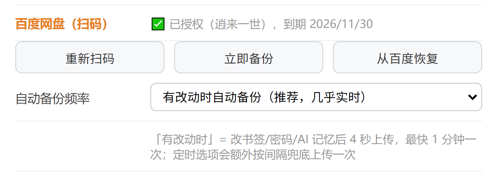

# 百度网盘备份 · 使用教程

> 一句话原理：**把你的书签、密码、AI 记忆加密打包成一个文件，存进你自己的百度网盘。** 解密只认你设的同步口令，百度看不到内容，中间也没有任何服务器。

---

## 它能做什么

| 场景 | 效果 |
|---|---|
| 平时 | 改了书签/密码，几秒后自动加密上传（也可设成每 5/15/30 分钟定时备份） |
| 重装系统 | 装好浏览器 → 扫码授权 → 点「从百度恢复」，数据全回来 |
| 换新电脑 | 同上，一步恢复 |

---

## 第一步：设同步口令（必须）

打开 **设置**（右上角齿轮）→ 往下找到 **数据同步** 区域 → 在「同步口令」里填一个至少 4 位的密码。

**这一步不能跳过**，它是加密用的钥匙：

- 口令 → 派生 AES-256 密钥 → 加密整个备份包
- **务必记牢**：口令丢了，云端文件永远解不开，谁都救不了
- **建议 8 位以上、字母数字混合**。4 位纯数字只要几分钟就能被暴力分析，等于没加密

---

## 第二步：扫码授权

在设置页同一区域找到 **百度网盘（扫码）**，点 **「扫码授权」**：

1. 屏幕上会弹出一个小的二维码窗口
2. 打开手机 **百度App** → 右上角「+」→ **扫一扫**
3. 扫描窗口里的二维码
4. 手机上点 **确认登录**
5. 之后全自动：自动跳转授权页 → 自动点「授权」→ 自动保存凭证 → 窗口自己关闭

成功后设置页会显示：

```
✅ 已授权（你的百度昵称），到期 2026/11/30
```

**不需要你在电脑上点任何按钮**，扫完等两三秒就行。

---

## 第三步：先手动备份一次

点 **「立即备份」**。成功会提示：

```
✅ 已备份到百度网盘，2.7 KB
```

备份文件在网盘的 **`/apps/liulanqi-sync/liulanqi-sync.lqs`**。

> 说明：`/apps/` 是百度给第三方应用划的专属目录，**网页版通常看不到**，别去网页版里翻。恢复也不用你手动找文件，点「从百度恢复」就行。

---

## 自动备份怎么选

设置页有个「自动备份频率」下拉框：

| 选项 | 适合谁 | 实际行为 |
|---|---|---|
| **有改动时自动备份**（默认） | 大多数人 | 改书签/密码/AI 记忆后 4 秒上传，最快 1 分钟一次；没改动就不传 |
| 每 5 分钟 | 多台设备频繁切换 | 额外定时兜底，没改动也传 |
| 每 15 分钟 | 日常使用 | 省流量，够用 |
| 每 30 分钟 | 改动少 | 最省 |
| 每 1 小时 | 只要兜底 | 几乎不占带宽 |

**选「定时」不会关掉「有改动就传」**，两者是叠加的：改了什么还是会立刻传一次。

---

## 换电脑 / 重装后怎么恢复

1. 在新电脑装好浏览器，打开设置
2. **填和旧电脑完全一样的同步口令**（这一步最容易填错）
3. 点「扫码授权」，用手机扫码（授权的是你自己的百度账号）
4. 点 **「从百度恢复」**

提示 `恢复完成` 就说明书签、密码、AI 记忆都回来了。

> 恢复采用**合并**方式：本机已有的不会丢，只补充缺的，不会覆盖掉你新电脑上的东西。

---

## 常见问题

**Q：扫完码窗口不消失 / 一直转圈**
先等 5 秒。程序内部会自动重试 2 次，两次都失败才会关窗并报错。如果反复失败，把 `data/baidu-auth.log` 发我，里面记了每一步。

**Q：点备份提示失败**
最常见是两种：① 没设同步口令（先设口令）；② 授权过期（点「重新扫码」）。

**Q：同步口令忘了怎么办**
本机还能继续用原来的备份，但**无法再解开云端旧文件**。解决办法：设一个新口令，重新备份一次（云端旧文件会被新文件覆盖）。所以重要的密码别只依赖这个口令，密码管理器里也存一份。

**Q：想换一个百度账号**
点「重新扫码」，扫另一个账号即可，新备份会覆盖旧文件。想保留两套就用不同的同步口令。

**Q：百度网盘里找不到那个文件**
正常。`/apps/` 是应用专属目录，网页版不展示。恢复请直接用「从百度恢复」按钮。

**Q：授权多久要重扫一次**
百度给的访问令牌有效期 30 天，程序会在快到期时用 refresh_token **自动续期**，正常情况下不用反复扫码。只有当你在百度账号里解除了这个应用的授权，才需要重扫。

**Q：这个文件会不会被百度看见**
文件是 AES-256-GCM 密文，百度只能看到一串乱码。但**前提是你的口令足够长**——口令太短，理论上可以被离线暴力分析。

---

## 隐私说明

- 数据只在你本机和你自己的百度网盘之间流动，**不经过任何中间服务器**
- 每个使用者扫的是**自己的**账号，备份进**自己的**网盘空间
- 本机保存的百度凭证用系统级加密（Windows DPAPI）存储，不走明文
- 想彻底断开：在百度账号的「授权管理」页面里撤销本应用授权

---

## 附：设置页长什么样



---

*本教程对应 AI 浏览器 v0.1.6 及以上版本。*
